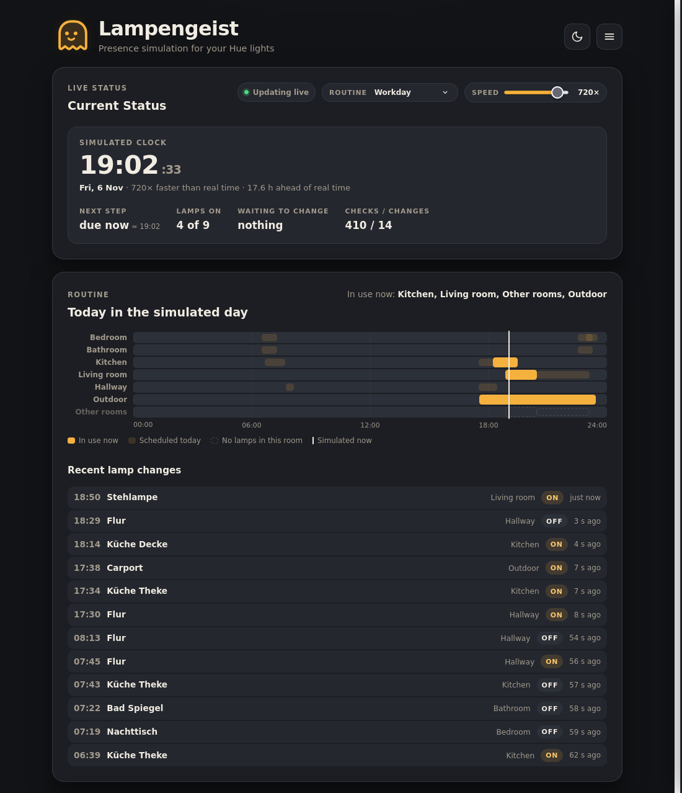
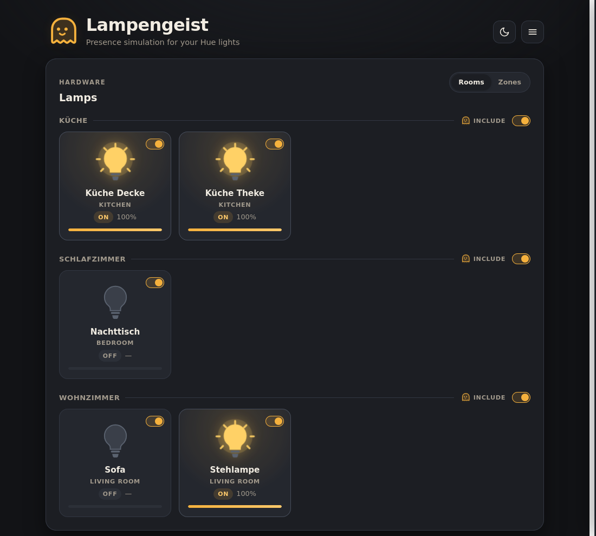

# Lampengeist

A presence simulator for Philips Hue. It switches your lamps on and off through
the day the way somebody living in the house would, so an empty home does not
look empty.

Lampengeist is a single Go binary with the web UI embedded in it. Point it at a
Hue bridge, pick a routine, and leave it running.



## What it does

A **routine** is a set of windows over a day — "bathroom and bedroom from
around 06:20 for about 50 minutes", "kitchen from 18:15", "outdoor lights all
evening". Each window names the kinds of room that are in use, and the simulator
keeps a plausible subset of the lamps in those rooms switched on for as long as
the window lasts.

Nine routines ship with it:

| Routine | The day it imitates |
|---|---|
| Workday | Wake up, leave for work, come back for a quiet evening |
| Home Office | Home all day, office lights during working hours |
| Weekend | A slow start, daytime puttering, a long evening at home |
| Night Owl | A late riser, with activity continuing past midnight |
| Student | Late nights studying, a slow morning |
| Shift Worker | Working late shifts or starting late |
| Pet Owner | Extra light morning and evening |
| Remote Hybrid | Office and living room presence spread through the day |
| Active Senior | Early start, long midday, quiet early evening |

Two details keep it from looking mechanical:

- **Windows are jittered per day.** Start times move by up to ten minutes and
  durations by a few more, derived from the date, so the routine never runs at
  exactly the same minute two days running.
- **One lamp changes per step**, every one to four simulated minutes. A whole
  room coming on at once does not look like somebody walking through a house —
  and it spikes bridge traffic.

## How your lamps get placed

Routines think in room *kinds* — bedroom, bathroom, kitchen, living room,
office, hallway, outdoor — so every lamp has to be sorted into one. Lampengeist
works through the evidence in order of how much it can be trusted:

1. **The room's archetype.** The Hue app stores one with every room and zone
   (`office`, `kitchen`, `garden`, `kids_bedroom`, …). It is an enum picked
   from a list of icons, so it works whatever language you named things in.
2. **The room's name**, against a vocabulary covering English, German, French,
   Dutch, Polish, Czech, Italian, Spanish, Portuguese, Norwegian, Swedish and
   Danish. Accents are folded, so `Küche`, `KUECHE` and `kuche` all land in the
   same place, and names match inside compounds — `Schlafzimmerlampe`,
   `keukenlamp`, `sovrumslampa`.
3. **Any zone the lamp is in.** People who name their rooms by floor
   ("Erdgeschoss") often do name their zones by purpose.
4. **The lamp's own name** — a `Schreibtischlampe` in an otherwise unnamed room
   is still an office lamp.

Each lamp card shows the category it ended up in, so you can see what the
simulator thinks your home looks like. If a routine asks for a room you have no
lamp in, that lane on the timeline is drawn dashed instead of silently doing
nothing.

## Choosing which lamps take part

Every lamp has a toggle, and every room or zone has one for the whole group.
Excluded lamps are left completely alone — the simulator never touches them.



## Watching it work

At 1× the simulated clock *is* the wall clock and a step happens every few
minutes, which is not much to look at. The speed slider runs the simulated clock
up to 1440× faster, so a whole day's routine plays out in about a minute and you
can watch the house wake up, empty out and settle down:

- the **simulated clock**, and how far it has run ahead of real time
- a **countdown** to the next step
- the **routine timeline** for the simulated day, with a marker at the current
  moment and the windows currently in use filled in
- a log of **recent lamp changes**, stamped in simulated time
- how many lamps are on, and how many the routine is still waiting to change

Dropping the speed back to 1× snaps the simulated clock back onto real time.
That matters: 1× is the mode that actually guards a house, and a clock left
hours ahead would switch lamps on in the middle of the night. **Leave the speed
at 1× for real use** — the faster settings are for watching and testing, and the
setting is persisted across restarts.

## Getting started

Needs Go 1.24 or newer, and a Hue bridge reachable on the local network.

```sh
go build -o lampengeist .
./lampengeist
```

Then open <http://localhost:64057>.

On first run there is no bridge configured. Open the menu (top right):

- **Scan for Bridges** finds a bridge on your network. Hit **Pair**, then press
  the physical link button on the bridge within 60 seconds.
- Or enter the bridge IP and an existing API token under **Manual setup**.

Credentials are written to `config.json` next to the binary, so the pairing
only has to happen once.

## Configuration

`config.json` is managed through the UI; there is no need to edit it by hand.

| Key | Meaning |
|---|---|
| `bridge_ip` | Address of the Hue bridge |
| `token` | Hue application key from pairing |
| `simulation_schedule` | ID of the active routine, e.g. `workday` |
| `simulation_speed` | 1–1440; 1 is real time |
| `simulation_lights` | Per-lamp opt-out; lamps not listed take part |
| `enabled` | Written on setup, not currently read |

The web server listens on `:64057`. That is not configurable yet.

## Running as a service

`lampengeist.service` is a systemd **user** unit — no root needed, and it runs
as you. It expects the binary at `~/git/lampengeist/lampengeist`; adjust
`ExecStart` and `WorkingDirectory` if you keep it elsewhere. The working
directory matters, because that is where `config.json` is read and written.

```sh
mkdir -p ~/.config/systemd/user
cp lampengeist.service ~/.config/systemd/user/
systemctl --user daemon-reload
systemctl --user enable --now lampengeist
```

User services normally stop when you log out, which is no good for something
that is supposed to be watching the house. Enable lingering once so it starts
at boot and keeps running without a session:

```sh
sudo loginctl enable-linger $USER
```

Logs go to the journal:

```sh
journalctl --user -u lampengeist -f
```

## HTTP API

The UI is built on these; they are stable enough to script against.

| Endpoint | Method | Purpose |
|---|---|---|
| `/api/status` | GET | Lamps, groups, and the full simulation state |
| `/api/discover` | GET | Look for a bridge on the network |
| `/api/join` | POST | Pair with a bridge (press the link button) |
| `/api/config` | GET, POST | Bridge address and token |
| `/api/schedules` | GET | The available routines |
| `/api/schedule` | GET, POST | The active routine |
| `/api/speed` | GET, POST | Simulation speed factor |
| `/api/simulation` | POST | Include or exclude lamps |

Bridge reads behind `/api/status` are cached — lamp state briefly, the room
layout for longer — so polling it does not flood the bridge.

## Development

```sh
go test ./...        # unit tests
go test -race ./...  # the simulator runs concurrently with the HTTP handlers
```

The UI is a single file, `templates/index.html`, embedded into the binary with
`go:embed`. There is no build step and no JavaScript dependencies.

Layout:

```
main.go                      HTTP handlers, bridge reads and caching
internal/presence/           the simulation loop and its clock
internal/schedules/          routines, window maths, room classification
internal/config/             config shape and defaults
internal/storage/            reading and writing config.json
templates/index.html         the whole UI
```

The screenshots above were taken against a stand-in bridge, with the simulation
fast-forwarded to a Friday evening.
